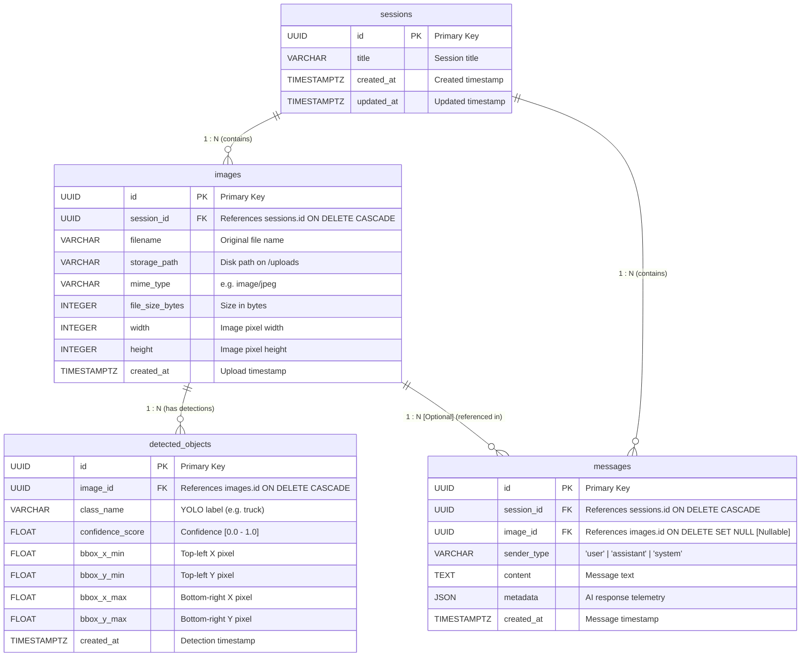

# Database Architecture, Schema Design & 7-Minute Defense Guide

**Project:** Conversational Image Recognition Chatbot  
**Organisation:** Bharat Electronics Limited (BEL)  
**Target Environment:** PostgreSQL 16 / Apple Silicon M4 & Linux  
**Status:** Production Verified  

---

## Executive Summary & Quick Reference

| Dimension | Specification | Implementation Detail |
| :--- | :--- | :--- |
| **Primary Database** | **PostgreSQL 16** (`postgres:16-alpine`) | Object-Relational Database (RDBMS) with native JSON support |
| **Access Layer** | SQLAlchemy 2.0 Async + `asyncpg` | Non-blocking async I/O via FastAPI (`AsyncSessionLocal`) |
| **Testing Datastore** | SQLite (`aiosqlite`) via `GUID` TypeDecorator | Automated zero-dependency fallback for local/CI test runs |
| **Primary Relational Tables** | `sessions`, `images`, `detected_objects`, `messages` | Strict relational schema with UUIDv4 surrogate primary keys |
| **Normal Form** | **3NF / BCNF** (Core Relational Tables) | Deliberate hybrid JSON denormalization in `messages.metadata` |
| **Cascade Constraints** | `CASCADE` on `sessions` $\to$ `images` & `objects` | `SET NULL` on `images` $\to$ `messages` to preserve chat history |
| **Core Transaction** | `replace_detected_objects` | Atomic delete + bulk insert with automatic rollback on error |
| **Key Indexes** | B-Tree on Foreign Keys & Timestamps | `session_id`, `image_id`, `created_at` indexed for $O(\log N)$ reads |
| **Storage Architecture** | Decoupled Hybrid Storage | Metadata in PostgreSQL; raw images on persistent disk (`/uploads`) |

---

# PART 1: The 7-Minute Spoken Presentation Script

*This script is calibrated for a comfortable speaking pace of **130–140 words per minute** (~950 words total). Each section corresponds to exactly one minute.*

---

### **Minute 1 [0:00 – 1:00]: Introduction & Why We Chose PostgreSQL (Q1)**
> "Hello everyone. 
> 
> Today, I’m presenting the database architecture powering our **Conversational Image Recognition Chatbot**, developed for defense reconnaissance operations with Bharat Electronics Limited.
> 
> In this system, users upload reconnaissance images, our AI detects objects with bounding boxes using **YOLOv8**, and users can ask follow-up questions using vision-language models like **BLIP**.
> 
> For our database, we chose **PostgreSQL 16**, an enterprise-grade **Relational Database** (RDBMS). We interface with it asynchronously using FastAPI, SQLAlchemy 2.0, and the `asyncpg` driver.
> 
> Why did we choose a relational database?
> Because our core data is deeply structured and relational. We track operational sessions, uploaded images, bounding box coordinates, and conversational dialogues that directly reference one another. 
> 
> At the same time, PostgreSQL natively supports **JSON**, which lets us store flexible AI response details without needing an entirely separate database."

---

### **Minute 2 [1:00 – 2:00]: Data Patterns & Why Not MongoDB? (Q1 Continued)**
> "Let’s look at how data moves through our system.
> 
> When an image is uploaded, we write one image record, followed by a batch insert of detected objects—typically five to thirty bounding boxes with coordinates and confidence scores. During chat, each user query and AI response creates two new message records.
> 
> On the read side, the most frequent action is opening a session and loading its previous messages so the AI retains multi-turn context.
> 
> We evaluated **MongoDB**, a popular document database, but rejected it for two reasons:
> 
> 1. **Documents get too big:** If you embed an image, dozens of bounding boxes, and hundreds of chat turns into a single session document, that document grows rapidly, leading to memory re-allocation overhead and risking MongoDB’s 16MB document limit.
> 2. **Clean deletion and referential safety:** In PostgreSQL, if you delete a session, the database automatically cascades and removes child images and boxes cleanly. Document databases cannot enforce this natively without custom application code.
> 
> PostgreSQL guarantees strong consistency and keeps our data clean."

---

### **Minute 3 [2:00 – 3:00]: Schema Walkthrough & The 4 Tables (Q2)**
> "Now, let’s walk through our schema. We designed it cleanly around **four core tables**:
> 
> 1. **`sessions`**: Stores the conversation title and audit timestamps.
> 2. **`images`**: Stores details about each picture—such as pixel width, height, file size, and disk path.
> 3. **`detected_objects`**: Stores every object YOLO detects—its class name, confidence score, and four bounding box coordinates ($x_{\min}, y_{\min}, x_{\max}, y_{\max}$).
> 4. **`messages`**: Stores each dialogue turn, who sent it, and what was said.
> 
> How do they connect?
> * One session has **many images** (a 1-to-many relationship).
> * One image has **many detected objects** (also 1-to-many).
> * One session has **many messages** (1-to-many).
> 
> A key design choice is how `messages` link to `images`: a message can optionally reference an image. 
> 
> If someone deletes an image, we configure that link to **`SET NULL`** instead of deleting the message. That way, the mission dialogue history is always preserved!"

---

### **Minute 4 [3:00 – 4:00]: Normal Form & Our Deliberate Shortcut (Q3)**
> "In database theory, our relational design is in **Third Normal Form (3NF)** and reaches **Boyce-Codd Normal Form (BCNF)**.
> 
> What does that mean in practice?
> * Every row has a single UUID primary key, so there are no partial dependencies.
> * There is no duplicate data repeated across tables.
> * Every attribute depends strictly on its primary key. For example, a bounding box’s coordinates depend solely on that specific detection ID, not on the parent image’s name.
> 
> However, we took **one deliberate engineering shortcut**—controlled denormalization.
> 
> In the `messages` table, we store extra AI metadata as JSON—such as model latency, detected classes, and VQA flags.
> 
> If we normalized this strictly by the textbook, we would need two extra tables and have to join three tables together on every single chat message. That would add unnecessary query latency.
> 
> By storing this small AI telemetry payload directly as JSON inside the message row, we fetch chat history in a single fast query. Correctness is enforced by Pydantic validation before saving, and messages are immutable once created."

---

### **Minute 5 [4:00 – 5:00]: Protecting Data & Safe Transactions (Q4)**
> "Next, how do we make sure our data stays correct and safe?
> 
> We enforce correctness on two levels:
> * **In the database:** We use `NOT NULL` constraints so essential fields cannot be empty, and Foreign Keys so no child data is ever orphaned.
> * **In our application code:** We use Pydantic models to ensure confidence scores are always valid numbers between 0% and 100%, and messages cannot be blank.
> 
> Here is a real-world example of **Transactions**:
> In our application, an analyst can drag a confidence slider to re-run object detection on an existing image. This requires **deleting the old bounding boxes and saving the new ones**.
> 
> What if the server crashed halfway through?
> We wrapped both steps inside an **atomic database transaction**. If anything fails during new object insertion, the database automatically **rolls back**. The old boxes stay untouched, and nothing is corrupted. We even wrote automated tests verifying this exact rollback safety."

---

### **Minute 6 [5:00 – 6:00]: Performance, Indexes & Smart Storage (Q5)**
> "Now let's talk about performance. How do we keep the database fast?
> 
> First, **we do not store image files inside the database**. Storing large image files in database tables causes table bloat and eats up cache memory. Instead, images are saved in an upload folder on disk, and PostgreSQL only stores the file path string.
> 
> Second, **we created smart B-tree indexes**:
> We indexed foreign keys like `session_id` and `image_id`, as well as message timestamps. When you open a chat, PostgreSQL jumps directly to that session’s messages in logarithmic time instead of scanning through millions of rows.
> 
> We also deliberately avoided unnecessary indexes. For example, we did not index object names, because YOLO inserts new boxes frequently, and extra indexes would slow down those write operations without providing real benefits."

---

### **Minute 7 [6:00 – 7:00]: Handling 100x Scale & Conclusion (Q5 Continued)**
> "Finally, what if our user base and data volume grew **100 times larger**?
> 
> Two things would break first:
> 1. Too many users would connect at once, overloading PostgreSQL’s connection pool.
> 2. The `detected_objects` table would grow to millions of rows, slowing down queries.
> 
> Here is our 100x scaling plan:
> 1. Add **PgBouncer** to pool database connections so thousands of users can share a tight pool of 100 database workers.
> 2. **Partition our tables by month**, so old data is kept separate and active chats stay fast in memory.
> 3. Move image files to cloud object storage like **AWS S3 or MinIO**.
> 4. Add **Redis** to cache the last 10 messages of active conversations in RAM.
> 
> To wrap up: our database is simple, safe, and built to handle both strict computer-vision coordinates and flexible AI chat. 
> 
> Thank you, and I am now ready for your questions!"

---

# PART 2: In-Depth Question-by-Question Technical Reference

---

### Q1. Why did you choose this database?

#### 1. Database Identification & Engine
* **Engine:** **PostgreSQL 16** (`postgres:16-alpine`), operated via asynchronous SQLAlchemy 2.0 with the `asyncpg` driver.
* **Type:** Relational Database Management System (RDBMS) with native JSON/JSONB support.
* **Testing Fallback:** Local automated testing automatically falls back to an asynchronous SQLite engine (`sqlite+aiosqlite`) via a custom `GUID` TypeDecorator in `backend/app/core/database.py#L14-L43`.

#### 2. Data Characteristics
1. **Strictly Structured Relational Core:** 
   * Sessions, image dimensions, pixel resolutions, file paths, and YOLO spatial bounding box coordinates ($x_{\min}, y_{\min}, x_{\max}, y_{\max}$). These require rigid data typing (Float, Integer, UUID, DateTime) for fast bounding-box math and spatial sector calculations.
2. **Semi-Structured AI Telemetry:** 
   * Multi-turn chat responses include variable diagnostic metadata: VQA flags, detected classes, primary visual subject, and millisecond latencies. Storing this inside PostgreSQL’s native `JSON` column gives schema flexibility without sacrificing relational integrity.
3. **Decoupled Binary Storage:** 
   * Raw image files are saved to disk (`/app/uploads`), storing only relative path strings in the database. This keeps table rows compact (~200–500 bytes per record) and maximizes database buffer cache hit ratios.

#### 3. Read and Write Access Patterns
* **Write Patterns:**
  * **Upload:** 1 write to `images` followed immediately by a batch write of 5 to 50 rows into `detected_objects`.
  * **Dialogue:** 2 sequential writes per turn (1 user prompt, 1 assistant response with metadata).
  * **Confidence Re-run:** Atomic batch delete of old detections + batch insert of new detections for an `image_id`.
* **Read Patterns:**
  * **History Window:** Fetching the last $N$ dialogue turns for an active session (`WHERE session_id = :id ORDER BY created_at ASC LIMIT 50`).
  * **Session Detail:** Hydrating a full session graph with images and detected objects via `selectinload`.

#### 4. Consistency Requirements
* **ACID Transactions:** Image records must never exist without an active session (`CASCADE`). Detection slider updates must be completely atomic: old detections must not be lost if inserting new detections fails.

#### 5. Alternatives Evaluated & Rejected
* **MongoDB (Document Database):**
  * *Rejected because:* Embedding hundreds of messages and dozens of bounding boxes inside a single Session document causes unbounded document growth, risking MongoDB’s 16MB document limit and triggering heavy BSON re-allocations in memory. Furthermore, MongoDB lacks native, database-enforced cascading deletes.
* **Redis (Key-Value Store):**
  * *Rejected because:* Lacks relational modeling, complex coordinate filtering, and persistent disk-backed audit trails required for defense systems.

#### 6. Actual Data Sample & Frequent Operations

##### Actual Database Record Sample
```json
{
  "session": {
    "id": "7c9e6679-7425-40de-944b-e07fc1f90ae7",
    "title": "Surveillance Sector Alpha",
    "created_at": "2026-11-22T18:10:00Z"
  },
  "image": {
    "id": "3fa85f64-5717-4562-b3fc-2c963f66afa6",
    "session_id": "7c9e6679-7425-40de-944b-e07fc1f90ae7",
    "filename": "recon_target.jpg",
    "storage_path": "/app/uploads/3fa85f64-5717-4562-b3fc-2c963f66afa6.jpg",
    "width": 1920,
    "height": 1080
  },
  "detected_object": {
    "id": "e2e00000-0000-0000-0000-000000000001",
    "image_id": "3fa85f64-5717-4562-b3fc-2c963f66afa6",
    "class_name": "truck",
    "confidence_score": 0.942,
    "bbox_x_min": 120.0,
    "bbox_y_min": 240.0,
    "bbox_x_max": 480.0,
    "bbox_y_max": 600.0
  },
  "message": {
    "id": "9b1deb4d-3b7d-4bad-9bdd-2b0d7b3dcb6d",
    "session_id": "7c9e6679-7425-40de-944b-e07fc1f90ae7",
    "sender_type": "assistant",
    "content": "Detected 1 truck with 94.2% confidence on the left.",
    "metadata": {
      "vqa_mode": true,
      "detected_classes": ["truck"],
      "latency_ms": 142.5
    }
  }
}
```

##### 3 Most Frequent Application Queries
```python
# 1. Fetch Session with Images & Detections (backend/app/repositories/session_repo.py#L22)
query = (
    select(SessionModel)
    .where(SessionModel.id == session_id)
    .options(
        selectinload(SessionModel.messages),
        selectinload(SessionModel.images).selectinload(ImageModel.detected_objects),
    )
)

# 2. Retrieve Dialogue History Window (backend/app/repositories/message_repo.py#L33)
query = (
    select(MessageModel)
    .where(MessageModel.session_id == session_id)
    .order_by(MessageModel.created_at.asc())
    .limit(50)
)

# 3. Atomic Replacement of Detections (backend/app/repositories/image_repo.py#L81)
await db.execute(delete(DetectedObjectModel).where(DetectedObjectModel.image_id == image_id))
for obj in db_objs:
    db.add(obj)
await db.commit()
```

---

### Q2. Walk us through your schema or data model.

#### 1. Entity-Relationship (ER) Diagram



#### 2. Entities, Keys, and Relationships

| Table | Primary Key | Foreign Key | Cardinality | Cascade Action |
| :--- | :--- | :--- | :--- | :--- |
| **`sessions`** | `id` (UUID) | None | Root operational entity | N/A |
| **`images`** | `id` (UUID) | `session_id` $\to$ `sessions.id` | **1 : N** with `sessions` | `ON DELETE CASCADE` |
| **`detected_objects`** | `id` (UUID) | `image_id` $\to$ `images.id` | **1 : N** with `images` | `ON DELETE CASCADE` |
| **`messages`** | `id` (UUID) | `session_id` $\to$ `sessions.id`<br>`image_id` $\to$ `images.id` | **1 : N** with `sessions`<br>**1 : N (optional)** with `images` | `ON DELETE CASCADE`<br>`ON DELETE SET NULL` |

#### 3. Resolution of Relationships (1:1, 1:N, M:N)
* **Parent-Child 1:N Links:** Handled directly through foreign keys on the child tables (`images.session_id`, `detected_objects.image_id`, `messages.session_id`).
* **M:N Resolution:** In general chat applications, an image might appear in multiple sessions (requiring an M:N join table). In this project, an image belongs to the single tactical session it was uploaded to (`session_id NOT NULL`), keeping the model clean and avoiding unnecessary join tables. Multiple messages within that session can reference the same `image_id`.

#### 4. Relational Join Query Code
```python
# backend/app/services/chat_service.py#L104
# Retrieves an image and joins all its detected objects
image = await ImageRepository.get_by_id(db, target_image_id, load_objects=True)

# Generated SQL:
# SELECT images.*, detected_objects.* 
# FROM images 
# LEFT OUTER JOIN detected_objects ON images.id = detected_objects.image_id 
# WHERE images.id = :image_id;
```

---

### Q3. What normal form is your design in, and where did you deliberately break it?

#### 1. Highest Normal Form Reached
The primary relational tables (`sessions`, `images`, and `detected_objects`) satisfy **Third Normal Form (3NF)** and reach **Boyce-Codd Normal Form (BCNF)**:
* **1NF:** All column values are atomic scalars (Float, Integer, String, UUID, Timestamp). No repeating groups.
* **2NF:** Every table uses a single-column surrogate primary key (`id`), eliminating any possibility of partial functional dependencies on composite candidate keys.
* **3NF:** No non-prime attribute has a transitive functional dependency on another non-prime attribute ($X \to Y \to Z$).
* **BCNF:** For every non-trivial functional dependency $X \to Y$, $X$ is a superkey.

#### 2. Functional Dependencies in `detected_objects`
$$\text{Schema} = \{ \underline{id}, image\_id, class\_name, confidence\_score, bbox\_x\_min, bbox\_y\_min, bbox\_x\_max, bbox\_y\_max, created\_at \}$$

* **Primary Functional Dependency:**
  $$\{ id \} \to \{ image\_id, class\_name, confidence\_score, bbox\_x\_min, bbox\_y\_min, bbox\_x\_max, bbox\_y\_max, created\_at \}$$
* Since `{id}` uniquely identifies every detected bounding box, the determinant $\{id\}$ is a superkey.
* Coordinates do not determine class names, and class names do not determine confidence scores. Every attribute depends directly on the key `{id}`.

#### 3. Deliberate Denormalization: Where, Why, and Correctness Maintenance
* **Where:** In the `messages` table on the `metadata` column:
  ```python
  metadata_payload = Column("metadata", JSON, default=dict)
  ```
* **Why Normalization was Broken:**
  1. **Schema Flexibility:** Telemetry attributes change across AI model versions (e.g. adding VQA flags, latency, or primary subjects).
  2. **Query Speed:** In strict 3NF, storing detected classes (an array) and latency metrics would require two extra tables. Joining them on every chat message bubble adds unnecessary database overhead.
* **How Correctness is Maintained:**
  * **Application-Layer Validation:** Pydantic v2 validates all metadata schemas before database writes (`backend/app/schemas/chat.py#L26-L32`).
  * **Write-Once Semantics:** Message records are immutable. Once written, they are never updated in place, preventing data drift.

---

### Q4. How does your database protect data correctness?

#### 1. Constraints Matrix: Database vs. Application Layer

| Constraint Type | Database Enforced | Application Enforced (Pydantic / FastAPI) |
| :--- | :--- | :--- |
| **PRIMARY KEY** | `id GUID PRIMARY KEY` on all 4 tables | Generates & validates RFC 4122 UUIDv4 |
| **NOT NULL** | `nullable=False` on structural columns | `min_length=1` on `content` (rejects empty messages) |
| **FOREIGN KEY** | `CASCADE` on session/image deletions;<br>`SET NULL` on message image links | Validates entity existence before insertion |
| **DOMAIN / RANGE** | Data types (Float, Integer, DateTime) | `confidence: float = Field(..., ge=0.0, le=1.0)` |
| **ENUM / SET** | Stored as `VARCHAR(20)` | `sender_type: Literal["user", "assistant", "system"]` |

#### 2. Transactions & Atomicity (Detection Replacement Example)
When a user adjusts the confidence threshold slider, the backend must delete existing detections for that image and insert the new detection set.

##### Transaction Code (`backend/app/repositories/image_repo.py#L81-L100`)
```python
@classmethod
async def replace_detected_objects(
    cls,
    db: AsyncSession,
    image_id: UUID,
    detections: List[dict],
) -> List[DetectedObjectModel]:
    try:
        # Step 1: Delete all existing detections for this image
        await db.execute(
            delete(DetectedObjectModel).where(
                DetectedObjectModel.image_id == image_id
            )
        )
        # Step 2: Build new ORM models
        db_objs = cls._build_detected_objects(image_id, detections)
        # Step 3: Add new models to the session
        for obj in db_objs:
            db.add(obj)
        # Step 4: Commit both operations atomically
        await db.commit()
        return db_objs
    except Exception:
        # Automatic rollback ensures previous records are preserved if anything fails
        await db.rollback()
        raise
```

#### 3. Concurrency & Isolation
* **PostgreSQL Isolation Level:** **Read Committed** (PostgreSQL default).
* **Guarantees:**
  * Prevents Dirty Reads: No transaction can read uncommitted rows modified by concurrent requests.
  * When `replace_detected_objects` executes, PostgreSQL acquires a **Row-Exclusive Lock** on the rows matching `image_id`. Any concurrent attempt to read or modify those exact detection records will wait or read the consistent committed state.
* **FastAPI Async Engine Architecture:**
  * Every HTTP request receives an isolated `AsyncSession` yielded by the dependency `get_db()`.
  * Sessions are never shared across threads or concurrent coroutines, eliminating dirty state bleeding between concurrent users.

#### 4. Test Proofs of Correctness
* **Constraint Rejection:** `test_image_bounding_box_schemas` in `backend/tests/test_schemas.py#L49` verifies that confidence $> 1.0$ is immediately rejected with a `ValidationError`.
* **Transaction Rollback:** `test_failed_detection_does_not_leave_partially_updated_database_records` in `backend/tests/test_detection_replacement_verification.py#L257` verifies that a failure during detection replacement rolls back cleanly, leaving original detections intact.

---

### Q5. How did you make your database usage efficient?

#### 1. Indexes Created & Supported Queries

```python
# Defined in backend/app/models/
# 1. images.session_id: Index=True
# Supports: SELECT * FROM images WHERE session_id = :session_id
session_id = Column(GUID, ForeignKey("sessions.id", ondelete="CASCADE"), nullable=False, index=True)

# 2. detected_objects.image_id: Index=True
# Supports: SELECT * FROM detected_objects WHERE image_id = :image_id
image_id = Column(GUID, ForeignKey("images.id", ondelete="CASCADE"), nullable=False, index=True)

# 3. messages.session_id: Index=True
# Supports: SELECT * FROM messages WHERE session_id = :session_id ORDER BY created_at ASC
session_id = Column(GUID, ForeignKey("sessions.id", ondelete="CASCADE"), nullable=False, index=True)

# 4. messages.created_at: Index=True
# Supports: Fast ordering of dialogue history without in-memory sorting
created_at = Column(DateTime(timezone=True), default=..., nullable=False, index=True)
```

* **Index Structure:** B-Tree (standard PostgreSQL).
* **Speedup:** Replaces slow $O(N)$ sequential table scans with fast $O(\log N)$ tree lookups.

#### 2. Indexes Considered But Rejected
* **Composite Index on `detected_objects(class_name, confidence_score)`:**
  * *Rejected because:* Detection re-runs write multiple rows at once. Maintaining an extra index on every slider movement slows down write operations. Because an image typically has only 5 to 30 objects, filtering by class in Python memory takes under 1 millisecond.
* **Full-Text GIN Index on `messages.content`:**
  * *Rejected because:* Chat queries focus on the active session's recent context window. A GIN index would slow down message inserts without providing significant benefits for our current use case.

#### 3. Techniques Used to Boost Speed
1. **Preventing $N+1$ Queries via `selectinload`:**
   * Instead of executing separate queries for each image and detection, `SessionRepository.get_by_id` uses `selectinload`:
     ```python
     query = select(SessionModel).where(SessionModel.id == session_id).options(
         selectinload(SessionModel.messages),
         selectinload(SessionModel.images).selectinload(ImageModel.detected_objects),
     )
     ```
   * SQLAlchemy issues two optimized queries using `IN (...)`, reducing database round-trips from dozens to just two.
2. **Decoupled Binary Storage:**
   * Images are saved to local persistent disk (`/uploads`). PostgreSQL only stores the file path string. This keeps table rows small and maximizes buffer cache hit ratios.
3. **Async Non-Blocking Engine:**
   * FastAPI uses `asyncpg` to run database queries asynchronously, allowing a single server worker to handle concurrent requests without thread blocking.

---

### 4. 100x Growth Scaling Blueprint

```
                           [ Incoming User Traffic ]
                                      │
                                      ▼
                       [ Reverse Proxy / Load Balancer ]
                                      │
                ┌─────────────────────┴─────────────────────┐
                ▼                                           ▼
       [ FastAPI Instance 1 ]                      [ FastAPI Instance 2 ]
                │                                           │
                ├─────────────────────┐                     │
                ▼                     ▼                     ▼
        [ S3 / MinIO Store ]    [ Redis Cache ]     [ PgBouncer Pooler ]
      (Offloaded Image Blobs)  (Last 10 turns RAM)   (Transaction Mode)
                                                            │
                                              ┌─────────────┴─────────────┐
                                              ▼                           ▼
                                    [ Primary PostgreSQL ]      [ Read Replica 1..N ]
                                     (Writes & Detections)     (Session & Chat Reads)
                                              │                           ▲
                                              └─ Streaming Replication ───┘
```

#### What Breaks First at 100x Scale?
1. **Connection Starvation:** Hundreds of concurrent users opening connections will exceed PostgreSQL’s `max_connections` limit.
2. **Table Bloat on `detected_objects`:** Millions of bounding boxes and frequent deletions will cause table bloat and disk I/O bottlenecks.

#### 100x Architectural Solutions:
1. **PgBouncer Connection Pooling:** Multiplex thousands of incoming client requests into a tight pool of 50–100 physical database connections.
2. **Declarative Range Partitioning:** Partition `detected_objects` and `messages` by month (`created_at`) so queries only scan active partitions.
3. **Read-Write Splitting (Replication):** Direct read queries (`list_sessions`, `get_session_detail`) to read replicas, freeing the primary database for image uploads and YOLO detection writes.
4. **Cloud Object Storage (MinIO / S3):** Offload `/uploads` from the local filesystem to S3-compatible storage with pre-signed URLs.
5. **Redis Cache:** Cache the last 10 messages of active conversations in RAM to eliminate 80% of repetitive database reads.

---

# PART 3: Panel Defense Q&A Cheat Sheet

| Question | Fast 15-Second Answer | Code Anchor in Project |
| :--- | :--- | :--- |
| **Why not SQLite in production?** | SQLite locks the entire database file on writes, causing severe bottlenecks under concurrent chat and image uploads. We use PostgreSQL for production and SQLite only for automated tests. | `backend/app/core/database.py#L48` |
| **How do you prevent the $N+1$ query problem?** | We use SQLAlchemy's `selectinload`. Instead of issuing separate queries for each image and detection, SQLAlchemy issues batched `IN (...)` queries. | `SessionRepository.get_by_id` |
| **Why use UUIDs instead of auto-increment integers?** | UUIDv4 prevents ID enumeration attacks, allows client-side ID pre-generation, and eliminates ID collisions if databases are merged. | `GUID` in `database.py` |
| **What happens if two users update detection at the same time?** | PostgreSQL acquires a row-exclusive lock on `detected_objects` for that `image_id`, serializing updates and preventing race conditions. | `ImageRepository.replace_detected_objects` |
| **Why isn't `messages.metadata` normalized into tables?** | AI telemetry fields evolve rapidly across models. Storing them as JSON avoids constant schema migrations and eliminates slow multi-table joins on every chat turn. | `MessageModel.metadata_payload` |
