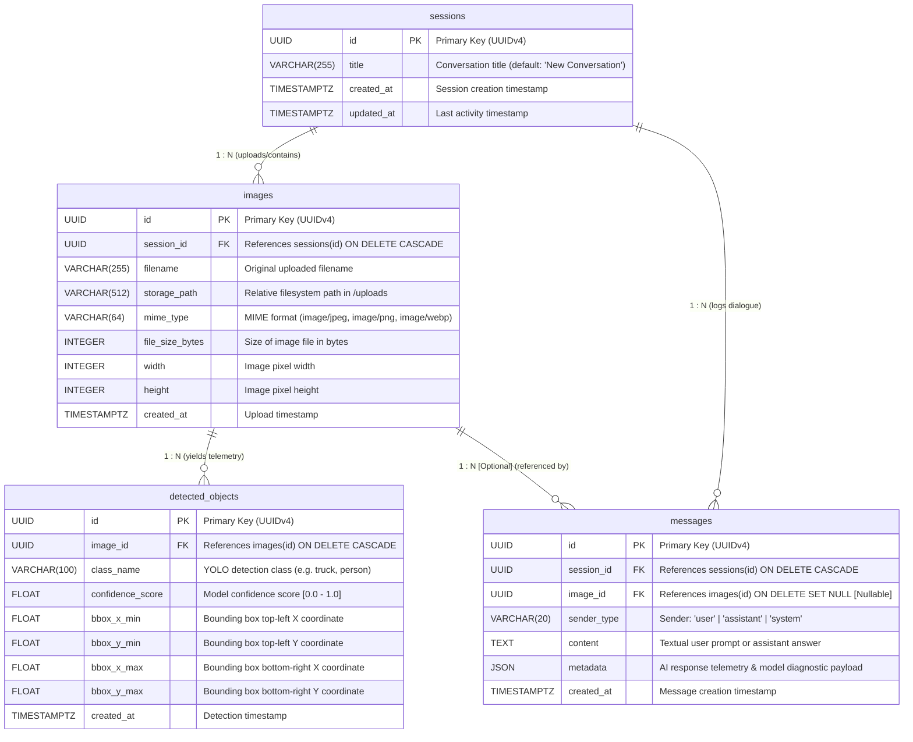

# Entity-Relationship (ER) Model

**Project:** Conversational Image Recognition Chatbot  
**Organisation:** Bharat Electronics Limited (BEL)  
**Database Engine:** PostgreSQL 16  
**ORM / Data Layer:** SQLAlchemy 2.0 (Async) + asyncpg  

---

## 1. Visual ER Diagram (Crow's Foot Notation)



---

## 2. Conceptual ER Model Breakdown

### Entities & Attributes

1. **`sessions` (Weak Entity: No; Strong Entity: Yes)**
   * **Key Attribute (Primary Key):** `id` (UUIDv4)
   * **Descriptive Attributes:** `title` (String), `created_at` (Timestamp with timezone), `updated_at` (Timestamp with timezone)
   * **Role:** The root conversational container. Groups multi-turn dialogue, uploaded reconnaissance images, and detections.

2. **`images` (Entity)**
   * **Key Attribute (Primary Key):** `id` (UUIDv4)
   * **Foreign Key:** `session_id` (UUIDv4)
   * **Descriptive Attributes:** `filename` (String), `storage_path` (String), `mime_type` (String), `file_size_bytes` (Integer), `width` (Integer), `height` (Integer), `created_at` (Timestamp with timezone)
   * **Derived / Virtual Property:** `url` (`/uploads/{filename}`)
   * **Role:** Represents persistent visual assets. Stores metadata and filesystem references without bloating database pages with raw binary data.

3. **`detected_objects` (Entity)**
   * **Key Attribute (Primary Key):** `id` (UUIDv4)
   * **Foreign Key:** `image_id` (UUIDv4)
   * **Descriptive Attributes:** `class_name` (String), `confidence_score` (Float), `bbox_x_min` (Float), `bbox_y_min` (Float), `bbox_x_max` (Float), `bbox_y_max` (Float), `created_at` (Timestamp with timezone)
   * **Derived / Virtual Properties:** `normalized_bbox` (coordinates divided by image width & height, rounded to 4 decimals), `confidence` (alias for `confidence_score`), `bbox` (dictionary representation)
   * **Role:** Stores localized bounding box telemetry produced by deep-learning models (YOLOv8).

4. **`messages` (Entity)**
   * **Key Attribute (Primary Key):** `id` (UUIDv4)
   * **Foreign Keys:** `session_id` (UUIDv4), `image_id` (UUIDv4, Optional/Nullable)
   * **Descriptive Attributes:** `sender_type` (String: 'user' | 'assistant' | 'system'), `content` (Text), `created_at` (Timestamp with timezone)
   * **Semi-Structured Attribute:** `metadata` (JSON payload containing `vqa_mode`, `vqa_answer`, `detected_classes`, `primary_subject`, `intent`, `latency_ms`, and `confidence_threshold`)
   * **Role:** Records sequential dialogue turns between analysts and multimodal AI agents.

---

## 3. Relationships & Cardinality Matrix

| Relationship | Parent Entity | Child Entity | Cardinality | Participation | On Delete Action | Description |
| :--- | :--- | :--- | :--- | :--- | :--- | :--- |
| **Session has Images** | `sessions` | `images` | **1 : N** | Total on Child | `CASCADE` | A session can contain zero, one, or many uploaded images. Each image belongs strictly to one session. |
| **Image has Detections** | `images` | `detected_objects` | **1 : N** | Total on Child | `CASCADE` | An image has zero, one, or many detected bounding boxes. Each box belongs strictly to one image. |
| **Session has Messages** | `sessions` | `messages` | **1 : N** | Total on Child | `CASCADE` | A session has zero, one, or many messages. Each message belongs strictly to one session. |
| **Message references Image** | `images` | `messages` | **1 : N** (Optional) | Partial on Child | `SET NULL` | A message may optionally reference an active image context. Deleting the image preserves the conversation history by setting `image_id` to `NULL`. |

---

## 4. Physical Data Dictionary

### Table: `sessions`
| Column Name | Data Type | Constraints | Default | Description |
| :--- | :--- | :--- | :--- | :--- |
| `id` | `UUID` (CHAR(36) on SQLite) | `PRIMARY KEY` | `uuid.uuid4` | Unique session identifier |
| `title` | `VARCHAR(255)` | `NOT NULL` | `'New Conversation'` | Human-readable title |
| `created_at` | `TIMESTAMPTZ` | `NOT NULL` | `CURRENT_TIMESTAMP` | Initial creation time |
| `updated_at` | `TIMESTAMPTZ` | `NOT NULL` | `CURRENT_TIMESTAMP` | Last modification time |

### Table: `images`
| Column Name | Data Type | Constraints | Index | Description |
| :--- | :--- | :--- | :--- | :--- |
| `id` | `UUID` | `PRIMARY KEY` | Yes (PK) | Unique image identifier |
| `session_id` | `UUID` | `NOT NULL`, `FK -> sessions(id) ON DELETE CASCADE` | Yes (B-Tree) | Parent session reference |
| `filename` | `VARCHAR(255)` | `NOT NULL` | No | Original filename |
| `storage_path` | `VARCHAR(512)` | `NOT NULL` | No | Filesystem storage path |
| `mime_type` | `VARCHAR(64)` | `NOT NULL` | No | Media type (image/jpeg, etc.) |
| `file_size_bytes` | `INTEGER` | `NOT NULL` | No | Raw file size in bytes |
| `width` | `INTEGER` | `NOT NULL` | No | Pixel width |
| `height` | `INTEGER` | `NOT NULL` | No | Pixel height |
| `created_at` | `TIMESTAMPTZ` | `NOT NULL` | No | Upload timestamp |

### Table: `detected_objects`
| Column Name | Data Type | Constraints | Index | Description |
| :--- | :--- | :--- | :--- | :--- |
| `id` | `UUID` | `PRIMARY KEY` | Yes (PK) | Unique detection identifier |
| `image_id` | `UUID` | `NOT NULL`, `FK -> images(id) ON DELETE CASCADE` | Yes (B-Tree) | Parent image reference |
| `class_name` | `VARCHAR(100)` | `NOT NULL` | No | Detected class label (e.g. truck) |
| `confidence_score`| `FLOAT` | `NOT NULL`, Domain: $[0.0, 1.0]$ | No | Detection confidence score |
| `bbox_x_min` | `FLOAT` | `NOT NULL` | No | Left horizontal boundary (px) |
| `bbox_y_min` | `FLOAT` | `NOT NULL` | No | Top vertical boundary (px) |
| `bbox_x_max` | `FLOAT` | `NOT NULL` | No | Right horizontal boundary (px) |
| `bbox_y_max` | `FLOAT` | `NOT NULL` | No | Bottom vertical boundary (px) |
| `created_at` | `TIMESTAMPTZ` | `NOT NULL` | No | Telemetry generation timestamp |

### Table: `messages`
| Column Name | Data Type | Constraints | Index | Description |
| :--- | :--- | :--- | :--- | :--- |
| `id` | `UUID` | `PRIMARY KEY` | Yes (PK) | Unique message identifier |
| `session_id` | `UUID` | `NOT NULL`, `FK -> sessions(id) ON DELETE CASCADE` | Yes (B-Tree) | Parent session reference |
| `image_id` | `UUID` | `NULLABLE`, `FK -> images(id) ON DELETE SET NULL` | No | Context image reference |
| `sender_type` | `VARCHAR(20)` | `NOT NULL`, Domain: `user` \| `assistant` \| `system` | No | Dialogue role |
| `content` | `TEXT` | `NOT NULL`, Length: $[1, 4000]$ | No | Message textual content |
| `metadata` | `JSON` | Default: `{}` | No | Multimodal diagnostic telemetry |
| `created_at` | `TIMESTAMPTZ` | `NOT NULL` | Yes (B-Tree) | Sequential turn timestamp |

---

## 5. PostgreSQL DDL Script

```sql
-- Create extension for UUID generation if needed
CREATE EXTENSION IF NOT EXISTS "uuid-ossp";

-- 1. sessions table
CREATE TABLE sessions (
    id UUID PRIMARY KEY DEFAULT gen_random_uuid(),
    title VARCHAR(255) NOT NULL DEFAULT 'New Conversation',
    created_at TIMESTAMP WITH TIME ZONE NOT NULL DEFAULT CURRENT_TIMESTAMP,
    updated_at TIMESTAMP WITH TIME ZONE NOT NULL DEFAULT CURRENT_TIMESTAMP
);

-- 2. images table
CREATE TABLE images (
    id UUID PRIMARY KEY DEFAULT gen_random_uuid(),
    session_id UUID NOT NULL REFERENCES sessions(id) ON DELETE CASCADE,
    filename VARCHAR(255) NOT NULL,
    storage_path VARCHAR(512) NOT NULL,
    mime_type VARCHAR(64) NOT NULL,
    file_size_bytes INTEGER NOT NULL,
    width INTEGER NOT NULL,
    height INTEGER NOT NULL,
    created_at TIMESTAMP WITH TIME ZONE NOT NULL DEFAULT CURRENT_TIMESTAMP
);

CREATE INDEX ix_images_session_id ON images(session_id);

-- 3. detected_objects table
CREATE TABLE detected_objects (
    id UUID PRIMARY KEY DEFAULT gen_random_uuid(),
    image_id UUID NOT NULL REFERENCES images(id) ON DELETE CASCADE,
    class_name VARCHAR(100) NOT NULL,
    confidence_score DOUBLE PRECISION NOT NULL,
    bbox_x_min DOUBLE PRECISION NOT NULL,
    bbox_y_min DOUBLE PRECISION NOT NULL,
    bbox_x_max DOUBLE PRECISION NOT NULL,
    bbox_y_max DOUBLE PRECISION NOT NULL,
    created_at TIMESTAMP WITH TIME ZONE NOT NULL DEFAULT CURRENT_TIMESTAMP
);

CREATE INDEX ix_detected_objects_image_id ON detected_objects(image_id);

-- 4. messages table
CREATE TABLE messages (
    id UUID PRIMARY KEY DEFAULT gen_random_uuid(),
    session_id UUID NOT NULL REFERENCES sessions(id) ON DELETE CASCADE,
    image_id UUID REFERENCES images(id) ON DELETE SET NULL,
    sender_type VARCHAR(20) NOT NULL,
    content TEXT NOT NULL,
    metadata JSON DEFAULT '{}'::json,
    created_at TIMESTAMP WITH TIME ZONE NOT NULL DEFAULT CURRENT_TIMESTAMP
);

CREATE INDEX ix_messages_session_id ON messages(session_id);
CREATE INDEX ix_messages_created_at ON messages(created_at);
```
